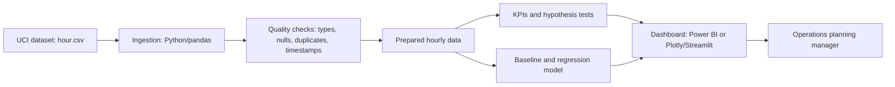

# Project Brief: Data-Driven Demand Planning for a Bike-Sharing Operator

**Course project — Dashboard session (Session 7)**  
**Student:** Ignacio Bartolomé Mochales  
**Date:** 20 October 2026

## Executive summary

This project proposes a dashboard for hourly demand planning, with forecasting as a later extension. The selected dataset is the UCI Bike Sharing dataset, representing Capital Bikeshare in Washington, D.C., during 2011–2012. My checks of `hour.csv` found 17,379 rows and 17 columns, no null values in recorded cells, no exact duplicate rows, and 165 absent date-hour combinations. These gaps must be investigated rather than automatically treated as zero rentals.

The dashboard supports human decisions, not automatic dispatch. System-wide totals cannot identify stations needing redistribution.

## 1. Dataset selection and dataset card

The **Bike Sharing** dataset was published by the UCI Machine Learning Repository and attributed to Hadi Fanaee-T [1]. I selected `hour.csv` because hourly granularity supports within-day demand analysis.

| Dataset-card field | Details |
|---|---|
| Name | Bike Sharing — hourly records (`hour.csv`) |
| Publisher | UCI Machine Learning Repository: https://archive.ics.uci.edu/dataset/275/bike+sharing+dataset |
| Attribution | Fanaee-T, H. (2013), *Bike Sharing*, DOI: https://doi.org/10.24432/C5W894 |
| Licence | Creative Commons Attribution 4.0 International (CC BY 4.0): https://creativecommons.org/licenses/by/4.0/ |
| Download checked | 20 October 2026; file: `hour.csv` |
| Grain | One row represents the system-wide rental count for one hour, not an individual trip or rider |
| Period | 1 January 2011–31 December 2012 |
| Verified size | 17,379 rows × 17 columns; 1,156,736 bytes (about 1.13 MiB) |
| Key fields | `dteday`, `hr`, `season`, `yr`, `mnth`, `weekday`, `workingday`, `holiday`, `weathersit`, `temp`, `atemp`, `hum`, `windspeed`, `casual`, `registered`, `cnt` |
| Target | `cnt`, total rentals per recorded hour |
| Other sources | None used in this first-stage analysis |

The dataset has multiple categorical dimensions and numeric measures, a documented target, over 12 months of data and a CC BY 4.0 licence requiring attribution [1][2].

### Data quality and limitations

Checks in Google Colab confirmed 17,379 records across 731 distinct dates. There were no null values within existing rows, no exact duplicate rows, and no duplicate `dteday`–`hr` combinations. Also, `casual + registered = cnt` was true for every recorded row.

However, 165 of the 17,544 possible date-hour combinations are absent (about 0.94%). In total, 76 dates have fewer than 24 records. Missing observations are concentrated in the early morning: hours 03:00 and 04:00 each account for 34 absences. The cause has not been established. Do not treat missing timestamps as zero demand automatically: this could bias hourly profiles, daily totals and modelling. Investigate them and document any treatment.

The weather variables are normalised, so they should not be interpreted directly as degrees Celsius or percentages. Historical data from one city may not represent current demand or other locations. Without station inventory, routes or individual records, it supports system-wide analysis only. For modelling `cnt`, `casual` and `registered` must be excluded from predictors because they sum exactly to the target, causing target leakage.

## 2. Business problem and decision

**Organisation:** Capital Bikeshare, the system represented by the dataset. This brief uses public historical data, not current internal operational systems.

**Department and stakeholder:** Operations and capacity planning; the intended user is an operations planning manager who reviews demand patterns when planning operational checks and capacity.

**Decision statement:** *The operations planning manager will use the dashboard to decide which hours, day types and weather conditions deserve additional monitoring or capacity planning.*

Constraints include the historical period, missing hours, normalised weather and no station-level stock or capacity. A live tool would need recent demand, inventory and cost information.

## 3. Hypotheses and KPIs

These are hypotheses to test, not results already established.

| ID | Hypothesis and metric | Test | Decision if true / false |
|---|---|---|---|
| H1 | Demand differs between working and non-working days. Metric: mean `cnt` by hour and `workingday`. | Compare hourly profiles and account for month or season. | If true, consider different schedules; if false, avoid unnecessary schedule differences. |
| H2 | Demand is concentrated in identifiable peak hours. Metric: mean and 90th percentile of `cnt` by hour. | Plot hourly demand, split by working-day status. | If true, focus checks around peaks; if false, use a broader operational schedule. |
| H3 | Weather conditions are associated with rental volume. Metric: mean `cnt` by `weathersit` and temperature band. | Compare group sizes and distributions. | If true, consider weather-aware planning; if false, do not rely on weather alone. |
| H4 | A model using calendar, time and weather features outperforms a historical-average baseline. Metric: test-set MAE and RMSE. | Use a chronological train/test split and inspect errors by season and hour. | If true, show forecasts with limitations; if false, retain descriptive analysis and revise the model. |

### Dashboard KPIs

1. **Total rentals:** sum of `cnt` for the selected period, compared by month, season and working-day status.
2. **Average hourly rentals:** sum of `cnt` divided by the number of valid recorded hours; report coverage because some timestamps are absent.
3. **Peak-hour demand:** highest mean `cnt` among the 24 hour-of-day groups, with the hour and day type shown.
4. **High-demand level:** 90th percentile of hourly `cnt`, compared with the median.
5. **Forecast MAE:** mean absolute error on a held-out chronological period; lower is better and should be compared with the baseline.
6. **Forecast bias:** mean of predicted minus actual rentals; indicates systematic over- or under-prediction.

Set numeric targets only after measuring a baseline. Use the model only if it beats the baseline on a chronological test period. Planning for peak demand may improve service but raise costs.

## 4. Proposed solution and architecture

**Solution type:** a management dashboard, with a forecasting engine considered as a later extension. The dashboard will show trends, hourly profiles, comparisons by working-day status and weather, KPI cards, and filters for date, season, month and weather. A forecast panel should only be added after evaluation.

**Inputs → logic → outputs:** load the UCI CSV with Python and pandas; validate types, ranges, categories and timestamp coverage; prepare an analytical table; calculate KPIs and test hypotheses; later compare a regression model against a baseline. Exclude `casual` and `registered` from predictors when `cnt` is the target. The output is evidence for the planning manager, not an automatic dispatch instruction.

| Layer | Role and tool | Refresh |
|---|---|---|
| Source | UCI dataset and CSV documentation | Manual download |
| Ingestion | Python and pandas load the file and record provenance | Each run |
| Quality | Validate types, nulls, duplicates, ranges, categories and missing timestamps | Each run |
| Data model | Prepared hourly table stored as CSV or Parquet | Each run |
| Analytics | pandas for KPIs and hypothesis tests; scikit-learn for a later model | Each run |
| Dashboard | Power BI or Plotly/Streamlit for filters, charts and KPIs | After pipeline run |

For this coursework, refresh is manual. A deployed version needs an owner and schedule. Schema changes should stop the pipeline and be reviewed. Keep code and documentation in the repository; store large raw files separately with download instructions and a checksum.

### Risks, ethics and alternatives

Historical patterns may not transfer to current demand, so show the data period and qualify forecasts. Missing timestamps may bias comparisons. Aggregated counts limit privacy exposure; future live data requires privacy and lawful-use checks. CC BY 4.0 requires attribution [2]. Fixed schedules and staff experience are simpler alternatives; use the dashboard if it adds useful evidence without unnecessary complexity.

## 5. Executive action summary

First, validate and document the missing timestamps. Next, compare hourly demand by working-day status, season and weather, while reporting record coverage. Establish baseline KPI values before setting numeric targets. Only introduce a forecast if it outperforms a historical-average baseline on a chronological test set and its errors are reported by season and hour. Exact station redistribution is outside the dataset’s scope and would require station-level inventory and trip data.

## References

[1] Fanaee-T, H. (2013). *Bike Sharing*. UCI Machine Learning Repository. https://doi.org/10.24432/C5W894. Dataset description: https://archive.ics.uci.edu/dataset/275/bike+sharing+dataset

[2] Creative Commons. *Attribution 4.0 International (CC BY 4.0) licence*. https://creativecommons.org/licenses/by/4.0/
